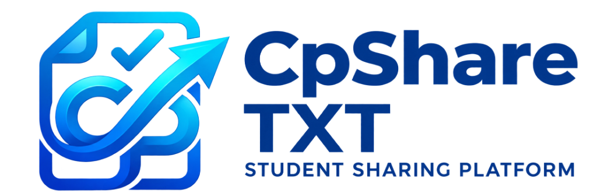

<div align="center">

  

  # 🌐 CPShareTXT — Student Sharing Platform

  **Free, Ephemeral & Secure Content Sharing Web Application Tailored for Education**

  [](LICENSE)
  [](#-creator--genesis)
  [](#-maintenance--scaling)
  [](https://www.php.net/)
  [](https://www.mysql.com/)
  [](https://getbootstrap.com/)

  <p align="center">
    <a href="#-about-the-project">About</a> •
    <a href="#-key-features">Features</a> •
    <a href="#-architecture">Architecture</a> •
    <a href="#-quick-start">Quick Start</a> •
    <a href="#-creator--genesis">Creator Story</a> •
    <a href="#-license">License</a>
  </p>

</div>

---

## 📖 About The Project

**CPShareTXT** is a lightweight, high-performance web platform engineered specifically for **university undergraduates, school children, coding labs, and educators**. It solves a daily classroom headache: quickly transferring lecture notes, homework files, research documents, and programming source code across computers without logging into personal social media or Google accounts on public workstations.

### 🎯 Primary Beneficiaries
- 🎓 **University Undergraduates:** Share code snippets, SQL dumps, and lecture summaries during lab practicals with zero registration.
- 🎒 **School Children & Teachers:** Exchange worksheets, assignments, and reading PDFs safely without annoying pop-ups or ads.
- 💻 **Developers & Coding Labs:** Share formatted code snippets, configs, or terminal logs with instant 5-minute ephemeral auto-destruction.

---

## 🚀 Key Features

- ⏱️ **5-Minute Ephemeral Purge:** Text snippets auto-destruct automatically after 5 minutes for privacy, or can be protected for 30 days.
- 📁 **25 MB File Payloads:** Drag-and-drop document, image, PDF, and code upload with instant shareable links.
- 🔒 **Vault Password Protection:** Sensitive files can be locked with a security key, preventing unauthorized downloads.
- 🌓 **Synchronized Cyber Dark / Light Theme:** Modern cyber-glassmorphism theme with persistent localStorage state and mobile drawer.
- 🔔 **Custom Creative Alerts:** SweetAlert2 notifications restyled to seamlessly blend with the cyber glassmorphism design.
- 🗄️ **Centralized Database (`db.php`):** Single point of database configuration supporting environment variables and automatic host fallback.
- ⚡ **High-Speed JSON API (`load_data_json.php`):** Asynchronous live search and retrieval for active sharing records.
- 🔍 **Search & Search Filter:** Live client-side search across usernames, aliases, and payload previews.
- 📱 **100% Mobile Responsive:** Optimized navigation, hamburger drawer, and card-based data representations on smaller screens.

---

## 🏗️ Architecture & Project Structure

```
CPShareTxt_WebSite/
├── db.php                 # Centralized MySQL connection gateway (single source of truth)
├── index.html             # Main sharing studio: notes, code & 25MB file upload portal
├── display_data.html      # Saved texts viewer: search, view, copy & protect
├── backend.php            # File vault manager: lock/unlock, download & delete controls
├── about.html             # Platform story, educational mission & maintainer details
├── feedback_form.html     # User feedback & suggestion dispatch form
├── admin_panel.php        # Secure admin console: upload limits & auto-purge timing
│
├── load_data_json.php     # High-speed JSON API endpoint for saved text records
├── load_data.php          # Server-side HTML table-render fallback endpoint
├── save_text.php          # Backend processor for text/code snippets
├── save_file.php          # Backend processor for uploaded file payloads
├── delete_data.php        # Backend handler to delete records
├── update_protection.php  # Backend handler to toggle 30-day retention protection
├── verify_password.php    # Password verification endpoint for locked files
├── cleanup.php            # Automated cron cleanup routine for expired items
├── download.php           # Secure binary download stream helper
│
├── styles.css             # Unified cyber-glassmorphic stylesheet (light/dark theme)
├── logo.png               # Official CpShare TXT brand logo
├── .htaccess              # Security headers, file size limits & MIME types
├── .gitignore             # Git exclusions
├── LICENSE                # MIT License
└── README.md              # Project documentation
```

---

## 🛠️ Quick Start & Installation

### Prerequisites
- PHP 7.4, 8.0, 8.1, or 8.2+
- MySQL 5.7+ or MariaDB
- Local web server (XAMPP, WampServer, Laragon) or any standard Linux/cPanel host

### Setup Steps

1. **Clone the Repository:**
   ```bash
   git clone https://github.com/kavizzz03/CPShareTxt_WebSite.git
   cd CPShareTxt_WebSite
   ```

2. **Import Database:**
   - Open phpMyAdmin or your MySQL client.
   - Create a database: `cpshare_db` (or your preferred name).
   - Import the schema from `Database/u569550465_dew.sql`.

3. **Configure Database Connection:**
   - Open `db.php` and verify your credentials:
     ```php
     define("DB_HOST", "localhost");
     define("DB_USER", "root");
     define("DB_PASS", "");
     define("DB_NAME", "cpshare_db");
     ```
   - *Note: `db.php` automatically supports host fallback if deploying to cloud hosts.*

4. **Run the Application:**
   - Place inside your webroot (e.g., `htdocs/CPShareTxt`).
   - Navigate to `http://localhost/CPShareTxt/` in your browser.

---

## 👨‍💻 Creator & Genesis

- **Architect & Original Developer:** **Kavindu Bogahawatte**
  - **Origin:** Designed and engineered as a 2nd-year undergraduate Software Engineering student in Sri Lanka.
  - **Motivation:** Solved the problem of safely sharing lab codes and lecture drafts between university lab PCs and personal laptops without signing into personal social accounts.
  - **Milestone:** **1st deployed live project** launched into production in **December 2024**.
  - **Personal Portfolio:** [kavindubogahawatte.dev](https://www.kavindubogahawatte.dev/)

---

## 🛡️ Maintenance & Scaling

- **Active System Maintainer:** **Vexel IT**
- **Headquarters:** Colombo, Sri Lanka
- **Contact:** `info.vexelit@gmail.com`
- **Scope:** 24/7 uptime monitoring, database optimization, security patches, and community support for educational institutions.

---

## 📄 License

This project is licensed under the **MIT License** — see the [LICENSE](LICENSE) file for complete details. Free for students, educators, and institutions worldwide.
